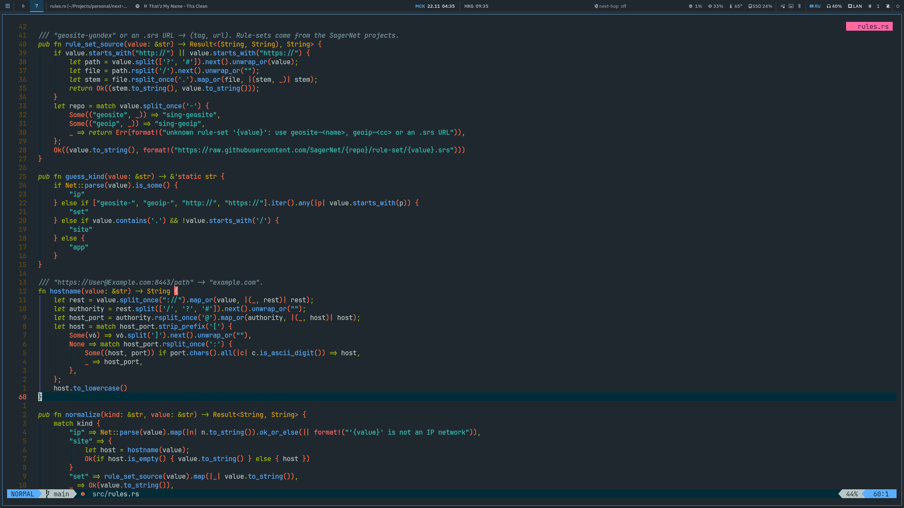
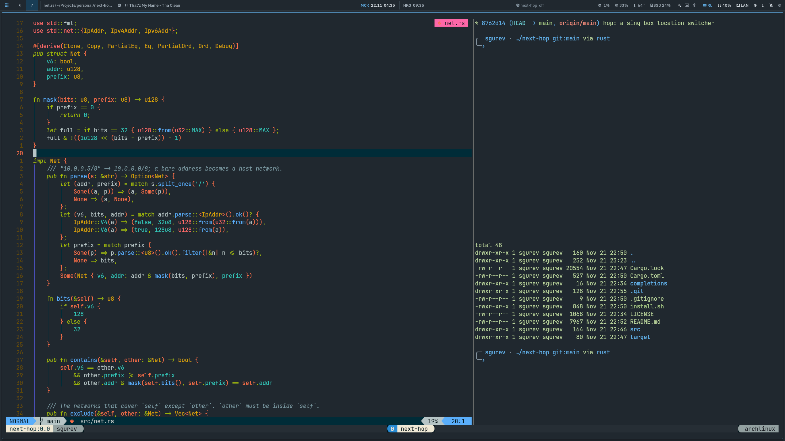

# dotfiles

Arch Linux desktop on Hyprland: a two-monitor layout built around network work,
with one black-and-ochre "bento" palette (Unit-01: red, ochre, green, grey cards, taken from
the SDDM login and hyprlock screens) across the bar, wallpaper, desktop widget, terminal,
launcher, notifications, btop, Firefox, GTK and Qt apps.


| Neovim | tmux |
|---|---|
|  |  |

## What is inside

| Path | What it is |
|---|---|
| `.config/hypr/` | Hyprland (Lua config), hypridle, hyprlock, hyprpaper |
| `.config/hypr/bento-desktop/` | wallpapers for each monitor (generated by `sddm/bento-login/desktop/gen-wallpaper.py`, `--style minimal` or `--style cards`) |
| `.config/hypr/scripts/desk-widget.py` | desktop widget (GTK3 + gtk-layer-shell, under the windows): Kubernetes, Git repositories, Docker containers, local LLM (Strata), ComfyUI queue and GPU |
| `.config/hypr/bento-lock/` | hyprlock bento screen: background, info script (generated by `sddm/bento-login/hyprlock/gen-hyprlock.py`) |
| `sddm/bento-login/` | SDDM login theme (Qt6/QML) in the same bento style, with `install.sh`, a systemd timer for the system info cards and a PAM fix for password + YubiKey |
| `.config/hypr/scripts/` | rofi menus: window overview, SSH hosts, Bluetooth, NetBox search, screen recording |
| `.config/waybar/` | two bar profiles (wide and compact), modules, style; `custom/gw` calls a private `~/.local/bin/mkt-gw` (router gateway switch), not included |
| `.config/waybar/scripts/` | public IP and country, NVMe wear, power menu |
| `.config/kitty/`, `.config/alacritty/` | terminals |
| `.config/fish/`, `.config/omf/`, `.config/starship.toml` | shell, prompt, tshark/termshark helpers |
| `.config/rofi/`, `.config/swaync/` | launcher and notification centre |
| `.config/gtk-3.0/`, `.config/gtk-4.0/` | GTK overrides |
| `.local/share/color-schemes/BentoUnit01.colors` | Qt/KDE colour scheme (Dolphin, polkit), applied by `.config/hypr/scripts/dark-theme.sh` |
| `sddm/bento-login/desktop/telegram/` | Telegram Desktop theme `bento.tdesktop-theme`, built by `sddm/bento-login/desktop/gen-telegram-theme.py` from the official night theme. Apply: Settings → Chat Settings → Chat wallpaper → Choose from file |
| `firefox/` | `userChrome.css`, `userContent.css` and `user.js` for the profile folder: bento colours, five toolbar buttons, no sidebar strip |
| `.config/nvim/` | Neovim 0.12 config, see below |
| `.config/tmux/` | tmux config, prefix `Ctrl+T`, see below |
| `.config/zed/`, `.config/Code/User/`, `.config/micro/` | editors, including three Zed themes |
| `docs/` | guides to this tmux and Neovim setup (in Russian) |
| `.config/btop/`, `.config/neofetch/`, `.config/glow/` | terminal tools, btop with the `bento` theme |
| `wallpapers/` | the wallpaper used by hyprpaper and hyprlock |

## Workspaces

| Workspace | Purpose |
|---|---|
| 1 | network: WinBox, NetBox |
| 2 | browser and terminal |
| 3 | code |
| 4 | monitoring: Grafana |
| 5 | notes |
| 6 | chat, kept on the second monitor |
| scratchpads | password manager, music, drop-down terminal |

## A few bindings

| Keys | Action |
|---|---|
| `SUPER` + `Return` | terminal |
| `SUPER` + `Space` | launcher |
| `SUPER` + `Tab` | all windows by workspace |
| `SUPER` + `X` | SSH hosts from `~/.ssh/config` |
| `SUPER` + `I` | NetBox search |
| `SUPER` + `` ` `` | drop-down terminal |
| `SUPER` + `Shift` + `R` | start or stop screen recording |
| `SUPER` + `H` | cheat sheet |

## Using it

These are my working files, not an installer. Copy what you need:

```sh
git clone https://github.com/gurevsergey/dotfiles.git
cp -r dotfiles/.config/waybar ~/.config/
```

Packages for the desktop part are listed in `.config/hypr/scripts/install-deps.sh`.
Fonts: JetBrainsMono Nerd Font, IBM Plex Sans, and Archivo Black, Space Grotesk and IBM Plex Sans JP (bold) for the bento screens and widget. The widget also needs `gtk-layer-shell` and `python-gobject`.

Things to change for your machine:

- monitor names and modes at the top of `.config/hypr/hyprland.lua`, and the output name in `.config/waybar/config.jsonc`
- `NETBOX` in `.config/hypr/scripts/netbox-search.py`; its API token is read from `~/.config/netbox-search/token`
- autostarted apps and web-app IDs in `hyprland.lua`
- the wallpaper paths in `hyprpaper.conf` and `hyprlock.conf`; regenerate both for your screens with
  `sddm/bento-login/desktop/gen-wallpaper.py` and `sddm/bento-login/hyprlock/gen-hyprlock.py`
- `GIT_ROOTS`, `STRATA` and the margins at the top of `.config/hypr/scripts/desk-widget.py`
- Firefox: copy `firefox/user.js` and `firefox/chrome/` into your profile folder (see `about:support`) while Firefox is closed

## Neovim and tmux

`.config/nvim` and `.config/tmux` come from [craftzdog/dotfiles](https://github.com/craftzdog/dotfiles)
by Takuya Matsuyama (commit `86edf45`); all credit for them goes to him. The Neovim config is unchanged.
For tmux I added `linux.conf` (true colour and undercurl in kitty, `wl-copy`, `xdg-open`) and the one
line in `tmux.conf` that loads it.

```sh
sudo pacman -S --needed neovim tmux lazygit tree-sitter-cli jq
git clone https://github.com/tmux-plugins/tpm ~/.config/tmux/plugins/tpm   # then prefix + I
```

Guides: [tmux](docs/tmux.md), [Neovim](docs/neovim.md).

The Waybar `hop` module belongs to [next-hop](https://github.com/gurevsergey/next-hop).
