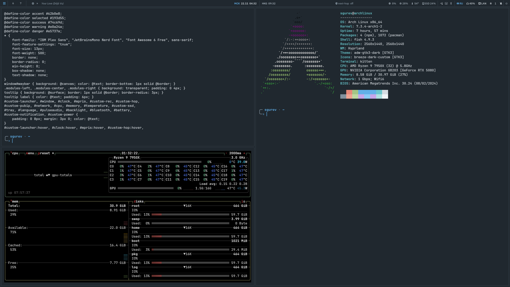

# dotfiles

Arch Linux desktop on Hyprland: a two-monitor layout built around network work,
with one graphite-and-blue palette (borrowed from WinBox 4) across the bar, terminal,
launcher, notifications, editors and GTK apps.



## What is inside

| Path | What it is |
|---|---|
| `.config/hypr/` | Hyprland (Lua config), hypridle, hyprlock, hyprpaper |
| `.config/hypr/scripts/` | rofi menus: window overview, SSH hosts, Bluetooth, NetBox search, screen recording |
| `.config/waybar/` | two bar profiles (wide and compact), modules, style |
| `.config/waybar/scripts/` | public IP and country, NVMe wear, power menu |
| `.config/kitty/`, `.config/alacritty/` | terminals |
| `.config/fish/`, `.config/omf/`, `.config/starship.toml` | shell, prompt, tshark/termshark helpers |
| `.config/rofi/`, `.config/swaync/` | launcher and notification centre |
| `.config/gtk-3.0/`, `.config/gtk-4.0/` | GTK overrides |
| `.config/nvim/` | Neovim 0.12 config, see below |
| `.config/tmux/` | tmux config, prefix `Ctrl+T`, see below |
| `.config/zed/`, `.config/Code/User/`, `.config/micro/` | editors, including three Zed themes |
| `docs/` | guides to this tmux and Neovim setup (in Russian) |
| `.config/btop/`, `.config/neofetch/`, `.config/glow/` | terminal tools |
| `wallpapers/` | the wallpaper used by hyprpaper and hyprlock |

## Workspaces

| Workspace | Purpose |
|---|---|
| 1 | network: WinBox, NetBox |
| 2 | browser and terminal |
| 3 | code |
| 4 | monitoring: Grafana |
| 5 | notes |
| 6 | chat, kept on the second monitor |
| scratchpads | password manager, music, drop-down terminal |

## A few bindings

| Keys | Action |
|---|---|
| `SUPER` + `Return` | terminal |
| `SUPER` + `Space` | launcher |
| `SUPER` + `Tab` | all windows by workspace |
| `SUPER` + `X` | SSH hosts from `~/.ssh/config` |
| `SUPER` + `I` | NetBox search |
| `SUPER` + `` ` `` | drop-down terminal |
| `SUPER` + `Shift` + `R` | start or stop screen recording |
| `SUPER` + `H` | cheat sheet |

## Using it

These are my working files, not an installer. Copy what you need:

```sh
git clone https://github.com/gurevsergey/dotfiles.git
cp -r dotfiles/.config/waybar ~/.config/
```

Packages for the desktop part are listed in `.config/hypr/scripts/install-deps.sh`.
Fonts: JetBrainsMono Nerd Font and IBM Plex Sans.

Things to change for your machine:

- monitor names and modes at the top of `.config/hypr/hyprland.lua`, and the output name in `.config/waybar/config.jsonc`
- `NETBOX` in `.config/hypr/scripts/netbox-search.py`; its API token is read from `~/.config/netbox-search/token`
- autostarted apps and web-app IDs in `hyprland.lua`
- the wallpaper path in `hyprpaper.conf` and `hyprlock.conf` (`~/Pictures/Wallpapers/`)

## Neovim and tmux

`.config/nvim` and `.config/tmux` come from [craftzdog/dotfiles](https://github.com/craftzdog/dotfiles)
by Takuya Matsuyama (commit `86edf45`); all credit for them goes to him. The Neovim config is unchanged.
For tmux I added `linux.conf` (true colour and undercurl in kitty, `wl-copy`, `xdg-open`) and the one
line in `tmux.conf` that loads it.

```sh
sudo pacman -S --needed neovim tmux lazygit tree-sitter-cli jq
git clone https://github.com/tmux-plugins/tpm ~/.config/tmux/plugins/tpm   # then prefix + I
```

Guides: [tmux](docs/tmux.md), [Neovim](docs/neovim.md).

The Waybar `hop` module belongs to [next-hop](https://github.com/gurevsergey/next-hop).
