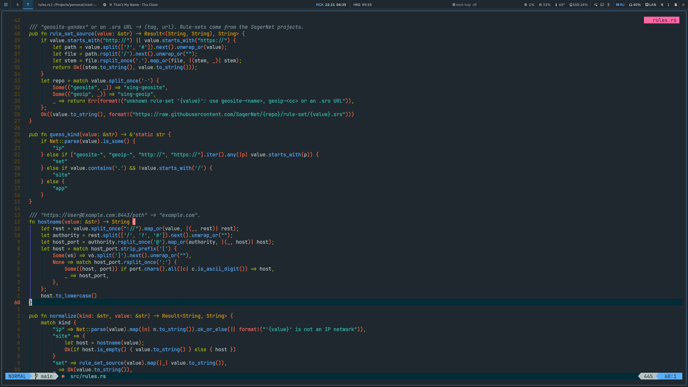

# Neovim — руководство



Руководство по Neovim в той конфигурации, что установлена в этом репозитории (конфиг craftzdog, Neovim 0.12). Где что лежит — в [Neovim и tmux](../README.md#neovim-and-tmux). Мультиплексор — в [tmux — руководство](tmux.md).

Первая половина — основы vim, которые работают в любом vim и на любом сервере. Вторая — то, что добавляет эта конфигурация.

> [!IMPORTANT]
> **Что в этой конфигурации отличается от обычного vim**
> - **Leader — пробел.** Запись `<leader>f` означает: пробел, затем `f`.
> - **Мышь отключена.** Всё делается с клавиатуры.
> - **Буфер обмена общий с системой.** `y` копирует в системный буфер, `p` вставляет из него.
> - **`x` не затирает буфер**, `s` занята под окна, `dw` удаляет слово **назад**, `Tab` переключает вкладки, `+` и `-` меняют число под курсором. Подробно — в разделе 7.

## 1. Режимы

Vim — модальный редактор: одни и те же клавиши в разных режимах делают разное.

| Режим | Как войти | Для чего |
|---|---|---|
| Normal | `Esc` | перемещение и команды; в нём проводят большую часть времени |
| Insert | `i`, `a`, `o` и другие | ввод текста |
| Visual | `v`, `V`, `Ctrl+V` | выделение символами, строками, блоком |
| Command | `:` | команды: сохранить, заменить, открыть |

Текущий режим показан слева в строке состояния. Командной строки внизу нет (`cmdheight = 0`): при нажатии `:` она всплывает окном в верхней части экрана.

## 2. Минимум, чтобы работать

| Клавиши | Действие |
|---|---|
| `i` | вводить текст перед курсором |
| `Esc` | вернуться в Normal |
| `:w` | сохранить |
| `:q` | закрыть окно; `:qa` — выйти совсем |
| `:wq` или `ZZ` | сохранить и закрыть |
| `:q!` | закрыть без сохранения |
| `u` / `Ctrl+R` | отменить / вернуть |

История отмен сохраняется между запусками (`undofile`): `u` работает и после закрытия файла.

## 3. Перемещение

| Клавиши | Куда |
|---|---|
| `h` `j` `k` `l` | влево, вниз, вверх, вправо |
| `w` / `b` / `e` | начало следующего слова / начало предыдущего / конец слова |
| `0` / `^` / `$` | начало строки / первый непробельный символ / конец строки |
| `gg` / `G` | начало / конец файла |
| `12G` или `:12` | строка 12 |
| `Ctrl+D` / `Ctrl+U` | полэкрана вниз / вверх |
| `%` | парная скобка |
| `f<символ>` / `t<символ>` | до символа в строке включительно / не доходя; `;` повторяет |
| `{` / `}` | к предыдущему / следующему абзацу |
| `*` / `#` | следующее / предыдущее вхождение слова под курсором |
| `Ctrl+O` / `Ctrl+M` | назад / вперёд по истории переходов |
| `zz` | поставить текущую строку в центр экрана |

Номера строк относительные: слева видно, сколько строк до нужной, поэтому `7j` или `4k` набираются без подсчёта. Дефис считается частью слова (`iskeyword`), так что `w` перешагивает `next-hop` целиком.

## 4. Редактирование: оператор + движение

Главная идея vim: команда складывается из **оператора** и **того, к чему он применяется**.

| Оператор | Действие |
|---|---|
| `d` | удалить (и положить в буфер) |
| `c` | удалить и перейти в Insert |
| `y` | скопировать |
| `>` / `<` | сдвинуть вправо / влево |
| `gu` / `gU` | в нижний / верхний регистр |
| `gc` | закомментировать |

Примеры: `d$` — удалить до конца строки, `c3w` — заменить три слова, `yG` — скопировать до конца файла, `gcc` — закомментировать строку. Оператор дважды применяет его к строке: `dd`, `yy`, `cc`, `>>`.

### Текстовые объекты

Работают после оператора или в Visual. `i` — внутри, `a` — вместе с окружением.

| Объект | Что это |
|---|---|
| `iw` / `aw` | слово / слово с пробелом |
| `i"` `i'` `` i` `` | внутри кавычек |
| `i(` `i[` `i{` | внутри скобок |
| `it` | внутри тега |
| `ip` | абзац |

`ci"` — заменить содержимое кавычек, где бы в них ни стоял курсор. `da(` — удалить скобки вместе с содержимым. `yip` — скопировать абзац.

### Частые команды

| Клавиши | Действие |
|---|---|
| `a` / `A` | вводить после курсора / в конце строки |
| `I` | вводить в начале строки |
| `o` / `O` | новая строка ниже / выше |
| `r<символ>` | заменить один символ |
| `J` | приклеить следующую строку |
| `p` / `P` | вставить после / перед курсором |
| `.` | **повторить последнее изменение** |
| `~` | сменить регистр символа |
| `Ctrl+V`, выделить, `I`, текст, `Esc` | вставить текст в начало нескольких строк |

`.` — самая полезная клавиша: сделали правку один раз, перешли к следующему месту, нажали `.`.

## 5. Поиск и замена

| Клавиши | Действие |
|---|---|
| `/текст` | поиск вперёд; `?текст` — назад |
| `n` / `N` | следующее / предыдущее совпадение |
| `:noh` | убрать подсветку найденного |
| `:%s/старое/новое/g` | заменить во всём файле |
| `:%s/старое/новое/gc` | то же с подтверждением каждой замены |
| `:'<,'>s/…/…/g` | заменить в выделенном (диапазон подставляется сам) |

Поиск не учитывает регистр, пока в запросе нет заглавной буквы (`ignorecase` + `smartcase`).

Поиск по всему проекту — `;r` (раздел 8).

## 6. Регистры и макросы

Регистр — именованный буфер. Указывается перед командой: `"ayy` копирует строку в регистр `a`, `"ap` вставляет из него.

| Регистр | Что в нём |
|---|---|
| `"` | последнее удалённое или скопированное |
| `0` | последнее **скопированное** (`y`), удаления его не затирают |
| `+` | системный буфер обмена |
| `_` | «чёрная дыра»: удалить, ничего не сохраняя |
| `a`…`z` | ваши именованные |

`:reg` показывает содержимое всех регистров.

Макрос: `qa` — начать запись в регистр `a`, выполнить действия, `q` — закончить. `@a` — воспроизвести, `10@a` — десять раз, `@@` — повторить последний. Во время записи в строке состояния виден индикатор.

## 7. Изменённые клавиши этой конфигурации

Здесь то, что ведёт себя иначе, чем в стандартном vim.

| Клавиши | Здесь | В стандартном vim |
|---|---|---|
| `x` | удаляет символ, **не трогая буфер** | удаляет и кладёт в буфер |
| `dw` | удаляет слово **перед** курсором | удаляет до начала следующего слова |
| `s…` | префикс команд окон | заменить символ (используйте `cl`) |
| `+` / `-` | увеличить / уменьшить число под курсором | строка ниже / выше |
| `Ctrl+A` | выделить весь файл | увеличить число |
| `Tab` / `Shift+Tab` | следующая / предыдущая вкладка | переход вперёд по истории |
| `Ctrl+M` | вперёд по истории переходов | то же, что `Enter` |

Удалить слово вперёд — `de` или `daw`.

### Работа без затирания буфера

Обычная проблема: скопировали текст, удалили что-то перед вставкой — и в буфере уже удалённое. Здесь для этого есть набор с leader:

| Клавиши | Действие |
|---|---|
| `<leader>d` / `<leader>D` | удалить (движение / до конца строки), не трогая буфер |
| `<leader>c` / `<leader>C` | заменить, не трогая буфер |
| `<leader>p` / `<leader>P` | вставить последнее **скопированное**, даже если после этого что-то удаляли |

Работают и в Visual: выделить, `<leader>p` — заменить выделенное скопированным.

### Прочее

| Клавиши | Действие |
|---|---|
| `<leader>o` / `<leader>O` | новая строка ниже / выше без продолжения комментария |
| `<leader>yf` | скопировать путь к файлу относительно проекта с номером строки |
| `<leader>yp` | то же с абсолютным путём |
| `<leader>cc` (Visual) | скопировать выделенное как блок кода Markdown с путём и строками |
| `<leader>bd` | закрыть все скрытые буферы |
| `<leader>j` | открыть `package.json` проекта в плавающем окне |

`<leader>yf` и `<leader>cc` удобны, чтобы показать место в коде в чате или передать его Claude.

## 8. Файлы, поиск, буферы

### Поиск (Snacks picker)

| Клавиши | Действие |
|---|---|
| `;f` | найти файл по имени (включая скрытые) |
| `;r` | поиск текста по проекту (ripgrep) |
| `;;` | вернуть последний поиск с тем же запросом |
| `\\` | список открытых буферов; если буфер уже показан в окне, переходит к нему |
| `;e` | диагностика: ошибки и предупреждения |
| `;n` | история уведомлений |
| `;h` | изменённые участки по git |

В окне поиска: печатать — фильтровать, `Ctrl+J` / `Ctrl+K` — вниз и вверх, `Enter` — открыть, `Ctrl+V` — в вертикальном разделении, `Ctrl+S` — в горизонтальном, `Esc` — в Normal (второй раз — закрыть), `?` в Normal — справка по клавишам.

### Файловый менеджер (oil)

`sf` открывает каталог текущего файла в плавающем окне. Каталог — это **обычный буфер**: файлы переименовываются, удаляются и создаются правкой текста.

| Клавиши | Действие |
|---|---|
| `Enter` | открыть файл или войти в каталог |
| `h` или `-` | каталог выше |
| `q` | закрыть |
| `g.` | показать или скрыть скрытые файлы |
| `g?` | справка |
| `:w` | **применить изменения** (покажет список операций и спросит подтверждение) |

Переименовать — исправить имя в строке. Удалить — `dd`. Создать — `o` и имя (с `/` на конце — каталог). Переместить — `dd` в одном каталоге, `p` в другом. До `:w` на диске ничего не меняется.

### Окна и вкладки

| Клавиши | Действие |
|---|---|
| `ss` / `sv` | разделить по горизонтали / по вертикали |
| `sh` `sj` `sk` `sl` | перейти в окно слева / снизу / сверху / справа |
| `Ctrl+W` затем `=` | выровнять размеры окон |
| `Ctrl+W` затем `o` | оставить только текущее окно |
| `:q` | закрыть окно |
| `te` | новая вкладка |
| `Tab` / `Shift+Tab` | следующая / предыдущая вкладка |

Буфер — открытый файл в памяти, окно — вид на буфер, вкладка — набор окон. Закрытие окна не закрывает буфер: он остаётся в списке `\\`.

## 9. Работа с кодом (LSP)

Языковые серверы ставит Mason при первом запуске: TypeScript/JavaScript, CSS, Tailwind, ESLint, Lua, Rust. Для остальных языков работают подсветка и отступы через Treesitter.

| Клавиши | Действие |
|---|---|
| `gd` | перейти к определению |
| `gD` | к объявлению |
| `gy` | к определению типа |
| `gI` | к реализации |
| `gr` | все места использования |
| `K` | документация по символу под курсором |
| `gK` | сигнатура функции (в Insert — `Ctrl+K`) |
| `Ctrl+J` | следующая ошибка или предупреждение с пояснением |
| `;c` | кто вызывает эту функцию |
| `]]` / `[[` | следующее / предыдущее упоминание символа |
| `<leader>ca` | действия: исправить, импортировать, извлечь |
| `<leader>cr` | переименовать символ во всём проекте |
| `<leader>cR` | переименовать файл с обновлением импортов |
| `<leader>cl` | какие серверы подключены к буферу |

Вернуться после перехода — `Ctrl+O`.

### Автодополнение

Меню появляется само при вводе.

| Клавиши | Действие |
|---|---|
| `Ctrl+N` / `Ctrl+P` или стрелки | выбрать вариант |
| `Enter` | принять выбранное |
| `Ctrl+E` | закрыть меню |
| `Ctrl+Space` | открыть меню или документацию вручную |
| `Tab` / `Shift+Tab` | перейти к следующему / предыдущему полю сниппета |

Работает и в командной строке после `:`.

### Форматирование

Файл форматируется **при каждом сохранении**: `stylua` для Lua, `shfmt` для shell, `fish_indent` для fish, `prettier` (или `oxfmt`, если в проекте есть его конфиг) для JS, TS, JSON, CSS, HTML, Markdown, YAML; для остального — средствами языкового сервера.

| Команда | Действие |
|---|---|
| `<leader>f` | отформатировать сейчас (в Visual — выделенное) |
| `:ToggleFormatter` | выключить или включить автоформат для текущего буфера |
| `:noa w` | сохранить один раз без форматирования |

> [!WARNING]
> **Чужие файлы**
> Автоформат переформатирует файл целиком. В чужом репозитории со своим стилем перед правкой выполните `:ToggleFormatter`, иначе в коммит попадут сотни посторонних изменений.

### Copilot

Плагин включён, но работает только после входа: `:Copilot auth`. Без подписки ничего не делает.

| Клавиши (Insert) | Действие |
|---|---|
| `Ctrl+L` | принять предложение целиком |
| `Alt+L` | принять одно слово |
| `Alt+Shift+L` | принять строку |
| `Alt+]` / `Alt+[` | следующее / предыдущее предложение |
| `Ctrl+]` | отклонить |

## 10. Git

| Клавиши | Действие |
|---|---|
| `;g` | lazygit в плавающем окне; `e` на файле открывает его в окне, откуда вызван lazygit |
| `]c` / `[c` | следующий / предыдущий изменённый участок |
| `<leader>gd` | показать изменения поверх текста: что было и что стало |
| `<leader>gh` | добавить участок в индекс или убрать из него |
| `<leader>gs` | добавить в индекс весь файл или убрать |
| `<leader>gb` | кто и когда менял текущую строку |
| `<leader>gB` | авторство по всему файлу |
| `<leader>go` | открыть версию файла из коммита, в котором менялась строка |
| `<leader>dv` | сравнение бок о бок в стиле VS Code |
| `<leader>dh` / `<leader>dH` | история текущего файла / всего репозитория |
| `;h` | список изменённых участков |

Изменённые строки отмечены в колонке слева от номеров.

## 11. Интерфейс

| Элемент | Что показывает |
|---|---|
| Строка состояния | режим, ветка git, корень проекта, путь к файлу, запись макроса, число ошибок, число изменённых строк |
| Колонка знаков | изменения git, ошибки и предупреждения |
| Метка в углу окна | имя файла (заметно при нескольких окнах) |
| Вкладки сверху | появляются, когда вкладок больше одной |
| Уведомления | всплывают справа; история — `;n` |

Тема — Solarized Osaka с прозрачным фоном: цвет фона берётся у терминала.

Цвета вида `#62b0e8`, `rgb(…)`, `hsl(…)` в тексте подсвечиваются самим цветом. Комментарии `TODO:`, `FIXME:`, `NOTE:`, `HACK:` выделяются; список по проекту — `:TodoQuickFix`.

## 12. Обслуживание

| Команда | Действие |
|---|---|
| `:checkhealth` | полная проверка: чего не хватает и что сломано |
| `:Mason` | установленные языковые серверы и форматтеры; `i` — установить, `X` — удалить, `U` — обновить всё |
| `:lua vim.pack.update()` | обновить плагины; покажет список изменений, `:w` — применить, `:q` — отменить |
| `:TSUpdate` | обновить парсеры Treesitter |
| `:LspRestart` | перезапустить языковой сервер |
| `:messages` | последние сообщения и ошибки |

Версии плагинов зафиксированы в `~/.config/nvim/nvim-pack-lock.json`. Перед обновлением плагинов сохраните копию этого файла: откат — вернуть файл и перезапустить nvim.

Парсер для нового типа файла ставится автоматически при первом открытии.

## 13. Настройка под себя

| Файл | За что отвечает |
|---|---|
| `init.lua` | порядок загрузки |
| `lua/craftzdog/config/options.lua` | опции редактора |
| `lua/craftzdog/config/keymaps.lua` | базовые клавиши |
| `lua/craftzdog/plugins/init.lua` | список плагинов |
| `lua/craftzdog/plugins/keymaps.lua` | клавиши плагинов |
| `lua/craftzdog/plugins/lsp.lua` | языковые серверы и инструменты Mason |
| `lua/craftzdog/plugins/editor.lua` | дополнение, форматирование, git |
| `lua/craftzdog/plugins/ui.lua` | тема, строка состояния, поиск |
| `after/lsp/*.lua` | настройки отдельных серверов |

Свои дополнения кладите в `lua/craftzdog/plugins/local.lua` — файл подключается, если существует, и не конфликтует с обновлением основного конфига:

```lua
-- ~/.config/nvim/lua/craftzdog/plugins/local.lua
vim.opt.mouse = "a"                       -- вернуть мышь
vim.keymap.set("n", "<leader>w", "<cmd>w<cr>", { desc = "Save" })
```

Добавить языковой сервер: дописать пакет в `ensure_installed` и имя сервера в `vim.lsp.enable` в `lsp.lua`. Для сетевой работы полезны `ansible-language-server`, `yaml-language-server`, `bash-language-server`, `pyright`.

## 14. Диагностика

| Симптом | Причина и решение |
|---|---|
| Вместо значков квадраты | нужен Nerd Font в терминале |
| При запуске ошибка про `vim.pack` или `ui2` | Neovim старше 0.12; `nvim --version` |
| Нет подсветки в файле | `:checkhealth nvim-treesitter`; нужны `tree-sitter` и `gcc` |
| Не работают `gd`, `K` | `<leader>cl` — подключён ли сервер; `:Mason` — установлен ли |
| `;r` ничего не находит | нужен `ripgrep`; `;f` требует `fd` |
| `;g` не открывается | не установлен `lazygit` |
| Сохранение переформатировало весь файл | `u`, затем `:ToggleFormatter` и `:w` |
| Не копируется в системный буфер | нужен `wl-clipboard`; `:checkhealth` покажет провайдера буфера |
| Цвета внутри tmux отличаются | см. диагностику в [tmux — руководство](tmux.md) |
| Что-то сломалось после правки | запустить без конфига: `nvim --clean` |

## 15. Шпаргалка

| Задача | Клавиши |
|---|---|
| Сохранить / выйти | `:w` / `:qa` |
| Отменить / вернуть | `u` / `Ctrl+R` |
| Найти файл | `;f` |
| Найти текст в проекте | `;r` |
| Открытые буферы | `\\` |
| Файловый менеджер | `sf` |
| Разделить окно | `ss` / `sv`, переход — `sh` `sj` `sk` `sl` |
| Вкладки | `te`, `Tab`, `Shift+Tab` |
| К определению / назад | `gd` / `Ctrl+O` |
| Использования | `gr` |
| Документация | `K` |
| Переименовать | `<leader>cr` |
| Исправить | `<leader>ca` |
| Следующая ошибка | `Ctrl+J` |
| Форматировать | `<leader>f` |
| Закомментировать | `gcc`, в Visual — `gc` |
| lazygit | `;g` |
| Изменения git | `]c` / `[c`, `<leader>gd` |
| Вставить скопированное | `<leader>p` |
| Удалить без буфера | `<leader>d` |
| Путь к файлу со строкой | `<leader>yf` |
